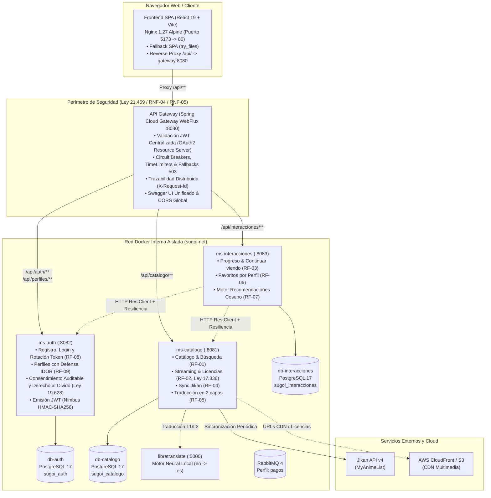

# SugoiAnime (すごいアニメ)
### Plataforma de Streaming de Anime Basada en Microservicios


**SugoiAnime** es una plataforma moderna de streaming y catálogo de anime diseñada bajo una **arquitectura de microservicios** distribuida, altamente escalable, resiliente y orientada al estricto cumplimiento normativo y legal chileno (**Leyes N° 17.336, N° 19.628 y N° 21.459**).

El sistema incluye reproducción de video streaming, sincronización externa con metadatos de anime, gestión completa de identidades con rotación de tokens JWT, perfiles familiares con defensa contra IDOR, seguimiento de progreso en tiempo real con throttling, favoritos con degradación elegante y un **motor de recomendaciones personalizadas** basado en aprendizaje de contenido (Similitud de Coseno).

---

## 📑 Tabla de Contenidos

- [Arquitectura del Sistema](#-arquitectura-del-sistema)
- [Mapa de Microservicios y Componentes](#-mapa-de-microservicios-y-componentes)
- [Funcionalidades y Requerimientos Implementados](#-funcionalidades-y-requerimientos-implementados)
  - [RF-01: Catálogo y Búsqueda de Anime](#rf-01-catálogo-y-búsqueda-de-anime)
  - [RF-02: Reproducción y Streaming Multimedia](#rf-02-reproducción-y-streaming-multimedia)
  - [RF-03: Progreso de Reproducción y "Continuar Viendo"](#rf-03-progreso-de-reproducción-y-continuar-viendo)
  - [RF-04: Sincronización Externa de Metadatos (Jikan API)](#rf-04-sincronización-externa-de-metadatos-jikan-api)
  - [RF-05: Traducción Automática con Caché Multinivel](#rf-05-traducción-automática-con-caché-multinivel)
  - [RF-06: Favoritos por Perfil con Degradación Elegante](#rf-06-favoritos-por-perfil-con-degradación-elegante)
  - [RF-07: Motor de Recomendaciones por Similitud de Coseno](#rf-07-motor-de-recomendaciones-por-similitud-de-coseno)
  - [RF-08: Gestión de Cuentas, Autenticación JWT y Consentimiento Auditable](#rf-08-gestión-de-cuentas-autenticación-jwt-y-consentimiento-auditable)
  - [RF-09: Perfiles Familiares, Control Parental y Defensa contra IDOR](#rf-09-perfiles-familiares-control-parental-y-defensa-contra-idor)
- [Cumplimiento Normativo y Legal (Chile)](#-cumplimiento-normativo-y-legal-chile)
- [Patrones de Resiliencia y Seguridad Perimetral](#-patrones-de-resiliencia-y-seguridad-perimetral)
- [Stack Tecnológico](#️-stack-tecnológico)
- [Referencia de la API REST (Gateway)](#-referencia-de-la-api-rest-gateway)
- [Guía de Instalación y Ejecución](#-guía-de-instalación-y-ejecución)
  - [Opción A: Despliegue Completo con Docker Compose (Producción / Integración)](#opción-a-despliegue-completo-con-docker-compose-producción--integración)
  - [Opción B: Entorno de Desarrollo Local Híbrido](#opción-b-entorno-de-desarrollo-local-híbrido)
- [Pruebas Automatizadas](#-pruebas-automatizadas)

---

## 🏗️ Arquitectura del Sistema

El sistema implementa una arquitectura desacoplada orientada a microservicios dentro de una red privada aislada (`sugoi-net`), donde ningún microservicio ni base de datos expone puertos al exterior:



---

## 📦 Mapa de Microservicios y Componentes

| Servicio / Contenedor | Puerto Interno (Docker) | Puerto Host (Prod / Dev) | Base de Datos / Storage | Responsabilidad Principal |
|---|:---:|:---:|---|---|
| **`frontend`** | `80` | `5173` | Nginx 1.27 / React SPA | Interfaz de usuario SPA, gestión de sesión con auto-refresh concurrente, selector de perfiles, reproductor HTML5 y proxy inverso `/api/` hacia el Gateway. |
| **`gateway`** | `8080` | Interno *(Prod)* / `8080` *(Dev)* | N/A (Stateless) | Perímetro de seguridad, enrutamiento reactivo, validación JWT en el borde, Circuit Breakers con fallbacks JSON, trazabilidad `X-Request-Id` y Swagger UI unificado. |
| **`ms-auth`** | `8082` | `8082` *(Dev)* / BD `5433` *(Dev)* | `sugoi_auth` (PostgreSQL 17) | Gestión de cuentas (BCrypt), emisión de JWT y rotación de Refresh Tokens, perfiles de visualización con defensa contra IDOR, y auditoría/eliminación de datos (Ley 19.628). |
| **`ms-catalogo`** | `8081` | `8081` *(Dev)* / BD `5434` *(Dev)* | `sugoi_catalogo` (PostgreSQL 17) | Catálogo de anime, géneros, gestión de episodios, streaming CDN con trazabilidad de licencias (Ley 17.336), traducción L1/L2 y sincronización con Jikan API. |
| **`ms-interacciones`** | `8083` | `8083` *(Dev)* / BD `5435` *(Dev)* | `sugoi_interacciones` (PostgreSQL 17) | Seguimiento de progreso de visualización, favoritos enriquecidos con degradación elegante y motor algebraico de recomendaciones por Similitud de Coseno. |
| **`libretranslate`** | `5000` | Interno *(Prod)* / `5000` *(Dev)* | `vol-libretranslate` (Modelos `en,es`) | Motor local autoalojado de traducción neuronal inglés $\rightarrow$ español para sinopsis del catálogo (RF-05). |
| **`rabbitmq`** *(opcional)* | `5672` | `5672 / 15672` *(Perfil `pagos`)* | RabbitMQ 4 Management | Mensajería asíncrona preparada para eventos de membresías y pagos. |

---

## 🚀 Funcionalidades y Requerimientos Implementados

### RF-01: Catálogo y Búsqueda de Anime
- **Exploración Paginada y Filtros Dinámicos:** Listado de títulos con soporte de paginación (`page`, `size`, `sort`) y combinación de filtros opcionales por género, año de lanzamiento exacto y búsqueda de texto en título (`GET /api/catalogo/animes`).
- **Ficha Técnica Detallada:** Consulta completa de información de un anime (`GET /api/catalogo/animes/{id}`), incluyendo título original/inglés, sinopsis (en español), año, estado de emisión, puntuación y lista completa de episodios ordenados.
- **Top Valorados & Géneros:** Endpoints dedicados para el carrusel de animes mejor calificados (`GET /api/catalogo/animes/top`) y catálogo de etiquetas de género (`GET /api/catalogo/animes/generos`).
- **Sincronización en Frontend:** La vista de Catálogo (`/catalogo`) refleja y persiste automáticamente el estado de los filtros en los parámetros de la URL, permitiendo compartir enlaces y mantener el historial de navegación del usuario.

### RF-02: Reproducción y Streaming Multimedia
- **Entrega de Contenido CDN:** Endpoint de streaming (`GET /api/catalogo/episodios/{id}/reproduccion`) que expone la URL optimizada servida a través de CDN (CloudFront / S3), duración y metadatos de reproducción.
- **Reproductor Interactivo HTML5:** Componente de video protegido en frontend (`/ver/:episodioId`) con controles de reproducción, reanudación automática en el segundo guardado, barra de tiempo interactiva y pantalla completa.
- **Transparencia Legal:** Cada episodio emitido expone explícitamente su campo `licencia` (cumplimiento obligatorio de la **Ley 17.336**).

### RF-03: Progreso de Reproducción y "Continuar Viendo"
- **Seguimiento Idempotente:** Endpoint `PUT /api/interacciones/progreso` que registra el segundo exacto, duración total y episodio en curso por perfil de usuario.
- **Finalización Automática:** El sistema detecta y marca automáticamente un episodio como completado cuando el usuario supera el 90% de su duración total.
- **Throttling en Cliente:** El frontend implementa el hook personalizado [`useProgreso`](file:///home/maha/Proyectos/sugoi-anime/frontend/src/hooks/useProgreso.js) con throttling a 10 segundos, asegurando que las actualizaciones se emitan periódicamente, al pausar o al abandonar la vista, evitando la saturación del Gateway.
- **Fila "Continuar Viendo":** Endpoint `GET /api/interacciones/progreso/continuar` que lista los episodios comenzados y no terminados ordenados cronológicamente, descartando automáticamente aperturas accidentales (< 30 segundos visualizados).

### RF-04: Sincronización Externa de Metadatos (Jikan API)
- **Ingestión de Datos Automatizada:** Integración con la API REST pública de Jikan v4 (MyAnimeList) para poblar y actualizar catálogo, imágenes, episodios y puntuaciones.
- **Protección con Circuit Breaker:** Mecanismo Resilience4j que previene bloqueos ante caídas o lentitud de la API externa.
- **Rate Limiting y Control Administrativo:** Respeto estricto a las cuotas de peticiones de Jikan y endpoint administrativo protegido por rol `ADMIN` (`POST /api/catalogo/admin/sincronizar?paginas=N`) para disparar sincronizaciones manuales.

### RF-05: Traducción Automática con Caché Multinivel
- **Traducción de Sinopsis:** Integración con LibreTranslate para disponibilidad del catálogo en idioma español.
- **Arquitectura de Caché en Dos Capas (L1/L2):**
  - **L1 (Memoria):** Caffeine Cache local de ultra-baja latencia.
  - **L2 (Persistencia):** Almacenamiento en base de datos PostgreSQL, evitando peticiones redundantes a la API de traducción.
- **Mantenimiento Administrativo:** Endpoint `POST /api/catalogo/admin/traducir` (rol `ADMIN`) para procesamiento por lotes de sinopsis pendientes.

### RF-06: Favoritos por Perfil con Degradación Elegante
- **Gestión de Favoritos:** Endpoints para marcar (`POST /api/interacciones/favoritos`), desmarcar (`DELETE /api/interacciones/favoritos/{animeId}`) y consultar estado instantáneo (`GET /api/interacciones/favoritos/estado`) por perfil.
- **Enriquecimiento Resiliente:** Los favoritos almacenados en `ms-interacciones` se enriquecen dinámicamente con título, portada y puntuación consultando a `ms-catalogo`.
- **Degradación Elegante:** Si `ms-catalogo` no se encuentra disponible temporalmente, el servicio responde igualmente con los identificadores del perfil y la bandera `datosCompletos: false`, manteniendo la disponibilidad de la interfaz sin arrojar errores 500.
- **Vista de Usuario:** Página dedicada "Mis Favoritos" (`/favoritos`) protegida por sesión y perfil activo.

### RF-07: Motor de Recomendaciones por Similitud de Coseno
- **Filtrado Basado en Contenido (Content-Based Filtering):** Cada anime se representa como un vector binario (*One-Hot Encoding*) en un espacio vectorial multidimensional de géneros.
- **Vector de Perfil:** El perfil de gustos del usuario se genera dinámicamente mediante la suma vectorial ponderada de los animes marcados como favoritos y los episodios completados.
- **Métrica de Similitud de Coseno:** Se calcula el ángulo entre el vector del perfil $\mathbf{u}$ y el vector del anime $\mathbf{v}$:
  $$\text{similitud}(\mathbf{u}, \mathbf{v}) = \frac{\mathbf{u} \cdot \mathbf{v}}{\|\mathbf{u}\| \|\mathbf{v}\|}$$
  Esto prioriza la **dirección y preferencia temática** en lugar de la cantidad absoluta de animes vistos (evitando sesgos entre usuarios novatos y veteranos).
- **Tratamiento del Arranque en Frío:** Si el perfil cuenta con menos de 2 interacciones, el sistema devuelve una lista vacía para no emitir sugerencias sin respaldo estadístico.
- **Pre-cálculo & Regeneración:** Endpoints para consultar recomendaciones (`GET /api/interacciones/recomendaciones`) y forzar su regeneración inmediata (`POST /api/interacciones/recomendaciones/regenerar`).

> [!NOTE]
> **Decisión Arquitectónica (De Machine Learning Colaborativo a Modelo Vectorial por Similitud de Coseno):**
> Si bien el alcance inicial del proyecto contemplaba un modelo predictivo de *Machine Learning* tradicional (filtrado colaborativo / entrenamiento supervisado), se optó por un motor determinista de **Filtrado Basado en Contenido con Similitud de Coseno** ([`RecomendacionService.java`](file:///home/maha/Proyectos/sugoi-anime/ms-interacciones/src/main/java/cl/sugoianime/msinteracciones/service/RecomendacionService.java)) por cuatro razones de ingeniería:
> 1. **Mitigación del Arranque en Frío (*Cold Start*):** Los modelos de ML colaborativos requieren miles de usuarios e interacciones históricas para converger; el enfoque vectorial por contenido opera con precisión desde el primer usuario apenas registra 2 interacciones.
> 2. **Explicabilidad y Determinismo:** A diferencia de un modelo de caja negra, cada puntaje recomendado es 100% trazable, auditable y verificable mediante pruebas unitarias deterministas.
> 3. **Cumplimiento de la Ley N° 19.628 (Aislamiento y Derecho al Olvido):** Al calcular el vector únicamente con el historial del propio perfil sin entrenar un modelo global compartido, la eliminación de una cuenta o revocación de consentimiento surte efecto inmediato sin requerir reentrenamiento (*Machine Unlearning*).
> 4. **Eficiencia Operacional en Microservicios:** Se ejecuta de forma nativa en Java 25 en pocos milisegundos sin requerir infraestructura adicional en Python/GPU ni pipelines externos de entrenamiento.

### RF-08: Gestión de Cuentas, Autenticación JWT y Consentimiento Auditable
- **Registro con Evidencia Legal (`POST /api/auth/auth/registro`):** Crea la cuenta maestra con contraseña hasheada mediante **BCrypt (factor de costo 12)**, genera automáticamente un perfil de visualización inicial y registra tres entradas auditables de consentimiento (`TERMINOS_Y_CONDICIONES`, `TRATAMIENTO_DATOS` y el opcional `HISTORIAL_RECOMENDACIONES`) junto con la versión vigente de los términos, fecha exacta e IP de origen (`X-Forwarded-For`).
- **Tokens de Doble Capa (`POST /api/auth/auth/login`):**
  - **`accessToken` (JWT, 15 min):** Firmado con HMAC-SHA256 (Nimbus JOSE + JWT), incluye claims `sub` (ID de usuario), `email`, `roles` e `iss` (`sugoianime-auth`).
  - **`refreshToken` (Opaco, 7 días):** Persistido en PostgreSQL para permitir revocación inmediata.
- **Rotación de Refresh Token (`POST /api/auth/auth/refresh`):** Al renovar la sesión, el refresh token utilizado se marca como revocado y se emite uno nuevo. En el frontend, [`client.js`](file:///home/maha/Proyectos/sugoi-anime/frontend/src/api/client.js) implementa una **guardia de concurrencia** (`refrescoEnCurso`) para que múltiples peticiones simultáneas que reciban `401` compartan una única llamada de renovación.
- **Cierre de Sesión y Derecho al Olvido:** Soporte para cerrar sesión en el dispositivo actual (`POST /api/auth/auth/logout`), revocar todas las sesiones activas (`POST /api/auth/auth/logout-todos`), eliminar permanentemente la cuenta y sus datos en cascada (`DELETE /api/auth/auth/cuenta`) y limpieza nocturna automática (`@Scheduled` a las 04:00 AM) de tokens vencidos o revocados.

### RF-09: Perfiles Familiares, Control Parental y Defensa contra IDOR
- **Multi-perfil por Suscripción (`/api/perfiles`):** Cada cuenta soporta hasta **5 perfiles independientes**, cada uno con nombre único dentro de la cuenta, avatar personalizado y bandera `esInfantil` (base para el control parental RF-11).
- **Defensa Estricta contra IDOR (Insecure Direct Object Reference):** El identificador del titular jamás se recibe por parámetro de consulta ni cuerpo; se extrae exclusivamente del claim criptográfico `sub` del JWT autenticado, y todas las consultas/modificaciones filtran simultáneamente por `id` de perfil y `usuarioId` (`findByIdAndUsuarioId`).
- **Regla de Integridad de Cuenta:** El sistema impide eliminar el último perfil restante de una cuenta (`409 Conflict`), garantizando que toda cuenta mantenga al menos un perfil operativo.
- **Selector Interactivo en Frontend (`/perfiles`):** Vista dedicada para elegir quién está viendo, crear nuevos perfiles (normales o infantiles) y administrar los existentes.

---

## ⚖️ Cumplimiento Normativo y Legal (Chile)

El diseño arquitectónico de SugoiAnime incorpora controles técnicos verificables para cumplir con la legislación chilena:

1. **Ley N° 17.336 (Propiedad Intelectual y Derechos de Autor):**
   - Todo el contenido multimedia servido posee un registro de trazabilidad en [`media/LICENCIAS.md`](file:///home/maha/Proyectos/sugoi-anime/media/LICENCIAS.md).
   - Solo se distribuyen obras de dominio público, material con licencias Creative Commons (ej. CC BY 3.0) o trailers promocionales libres.
   - El endpoint `GET /api/catalogo/episodios/{id}/reproduccion` expone la licencia obligatoria que el reproductor web renderiza bajo el video.
2. **Ley N° 19.628 (Protección de la Vida Privada y Datos Personales):**
   - **Consentimiento Auditable:** Tabla `consentimiento` en `ms-auth` que persiste la aceptación explícita de términos y tratamiento de datos, y de forma separada y opcional la autorización para el uso del historial en recomendaciones, guardando versión de términos, timestamp e IP real.
   - **Derecho de Eliminación (Cancelación / Olvido):** Endpoint `DELETE /api/auth/auth/cuenta` que borra de forma irreversible la cuenta, perfiles, consentimientos y tokens asociados (`ON DELETE CASCADE`).
3. **Ley N° 21.459 (Delitos Informáticos y Seguridad Perimetral):**
   - **Aislamiento de Red (RNF-04):** En [`docker-compose.yml`](file:///home/maha/Proyectos/sugoi-anime/docker-compose.yml), ni las bases de datos (`db-auth`, `db-catalogo`, `db-interacciones`) ni los microservicios internos exponen puertos al host; residen exclusivamente en la red bridge interna `sugoi-net`.
   - **Validación en el Borde (RNF-05):** El API Gateway valida criptográficamente la firma, expiración y emisor (`sugoianime-auth`) de cada JWT antes de enrutar tráfico hacia los servicios internos.

---

## 🛡️ Patrones de Resiliencia y Seguridad Perimetral

- **Database-per-Service (RNF-02):** Aislamiento estricto de datos. `ms-auth`, `ms-catalogo` y `ms-interacciones` poseen esquemas y motores PostgreSQL 17 independientes sin claves foráneas físicas cruzadas. La integridad referencial entre dominios es gestionada en la capa de aplicación (`PerfilGuard`, RestClients).
- **Circuit Breaker, TimeLimiter & Fallbacks Explícitos (Resilience4j):** Implementados tanto en el Gateway (`cbCatalogo`, `cbAuth`, `cbInteracciones` con [`FallbackController`](file:///home/maha/Proyectos/sugoi-anime/gateway/src/main/java/cl/sugoianime/gateway/controller/FallbackController.java) que retorna HTTP `503` estructurado con `circuitoAbierto: true`) como en las llamadas inter-servicio (`ms-interacciones` $\rightarrow$ `ms-catalogo` y `ms-auth`).
- **Trazabilidad Distribuida (`X-Request-Id`):** [`CorrelacionGlobalFilter`](file:///home/maha/Proyectos/sugoi-anime/gateway/src/main/java/cl/sugoianime/gateway/filter/CorrelacionGlobalFilter.java) en el Gateway genera o preserva un UUID en la cabecera `X-Request-Id`, lo propaga a todos los microservicios invocados, lo devuelve al cliente y registra en el log el tiempo total de respuesta en milisegundos.
- **Degradación Elegante (Graceful Degradation):** Servicios capaces de responder con información parcial (`datosCompletos: false` en favoritos) en caso de indisponibilidad de dependencias.

---

## 🛠️ Stack Tecnológico

### Backend
- **Lenguaje:** Java 25 (Virtual Threads habilitados para I/O concurrente eficiente).
- **Framework Base:** Spring Boot 4.1.1.
- **Cloud & Gateway:** Spring Cloud 2025.1.3, Spring Cloud Gateway Server WebFlux (`spring.cloud.gateway.server.webflux`).
- **Resiliencia:** Resilience4j (Circuit Breakers, TimeLimiters).
- **Seguridad:** Spring Security (WebFlux en Gateway y Servlet en microservicios), OAuth2 Resource Server, Nimbus JOSE + JWT (HMAC-SHA256) y BCrypt.
- **Persistencia & ORM:** Spring Data JPA, Hibernate, HikariCP.
- **Migraciones:** Flyway para versionado de esquemas relacionales.
- **Caché:** Caffeine Cache en memoria (L1) + PostgreSQL (L2).
- **Mensajería:** Spring AMQP + RabbitMQ 4.
- **Documentación de API:** SpringDoc OpenAPI 3.1.0 / Swagger UI centralizado en el Gateway.

### Frontend
- **Librería Core:** React 19 + ReactDOM 19.
- **Tooling & Bundler:** Vite 8.
- **Enrutamiento:** React Router DOM v7 con rutas protegidas por sesión y perfil.
- **Estilos:** Vanilla CSS modular con variables de diseño, tema oscuro cinemático y diseño responsivo.
- **Servidor Producción:** Nginx 1.27 Alpine con compresión `gzip`, caché inmutable de assets, fallback SPA (`try_files`) y reverse proxy `/api/`.

### Infraestructura y Pruebas
- **Bases de Datos:** PostgreSQL 17 Alpine (3 instancias aisladas: `db-auth`, `db-catalogo`, `db-interacciones`).
- **Contenedores:** Docker & Docker Compose con builds multi-etapa (*multi-stage*) y ejecución con usuario sin privilegios (`appuser`).
- **Testing:** JUnit 5, Mockito, AssertJ, Spring Security Test y Testcontainers (PostgreSQL 17 real en pruebas de integración).

---

## 🔌 Referencia de la API REST (Gateway)

Todas las peticiones externas e internas del cliente se canalizan a través del API Gateway:

### Identidad y Sesiones (`/api/auth/auth/**`)
| Método | Ruta | Acceso | Descripción |
|---|---|:---:|---|
| `POST` | `/api/auth/auth/registro` | Público | Registra cuenta, crea perfil inicial, audita consentimientos (Ley 19.628) y emite tokens (RF-08). |
| `POST` | `/api/auth/auth/login` | Público | Autentica credenciales y devuelve `accessToken` (15m) + `refreshToken` (7d). |
| `POST` | `/api/auth/auth/refresh` | Público | Rota el `refreshToken` y entrega un nuevo par de tokens sin pedir contraseña. |
| `POST` | `/api/auth/auth/logout` | Público | Revoca el `refreshToken` del dispositivo actual. |
| `POST` | `/api/auth/auth/logout-todos` | Bearer JWT | Revoca todos los refresh tokens activos del usuario en todos los dispositivos. |
| `GET` | `/api/auth/auth/yo` | Bearer JWT | Obtiene los datos de la cuenta autenticada a partir del claim `sub`. |
| `DELETE` | `/api/auth/auth/cuenta` | Bearer JWT | Elimina irreversiblemente la cuenta, perfiles, consentimientos y tokens (Ley 19.628). |

### Perfiles de Visualización (`/api/perfiles/**`)
| Método | Ruta | Acceso | Descripción |
|---|---|:---:|---|
| `GET` | `/api/perfiles` | Bearer JWT | Lista los perfiles pertenecientes a la cuenta autenticada (RF-09). |
| `POST` | `/api/perfiles` | Bearer JWT | Crea un nuevo perfil (máximo 5 por cuenta, soporte `esInfantil`). |
| `PUT` | `/api/perfiles/{id}` | Bearer JWT | Actualiza nombre, avatar o modo infantil de un perfil propio (protegido contra IDOR). |
| `DELETE` | `/api/perfiles/{id}` | Bearer JWT | Elimina un perfil propio (impide borrar el último perfil de la cuenta). |

### Catálogo y Streaming (`/api/catalogo/**`)
| Método | Ruta | Acceso | Parámetros Clave | Descripción |
|---|---|:---:|---|---|
| `GET` | `/api/catalogo/animes` | Público | `genero`, `anio`, `texto`, `page`, `size`, `sort` | Listado paginado de animes con filtros combinables (RF-01). |
| `GET` | `/api/catalogo/animes/{id}` | Público | `id` (path) | Detalle completo de un anime, géneros y episodios. |
| `GET` | `/api/catalogo/animes/top` | Público | `page`, `size` | Lista de animes mejor valorados. |
| `GET` | `/api/catalogo/animes/generos` | Público | — | Lista de géneros disponibles en el catálogo. |
| `GET` | `/api/catalogo/episodios` | Público | `animeId` (query) | Lista de episodios asociados a un anime. |
| `GET` | `/api/catalogo/episodios/{id}/reproduccion` | Público | `id` (path) | URL de CDN, duración y licencia de streaming (RF-02, Ley 17.336). |
| `POST` | `/api/catalogo/admin/sincronizar` | `ROLE_ADMIN` | `paginas` (default: 2) | Disparo manual de sincronización con Jikan API (RF-04). |
| `POST` | `/api/catalogo/admin/traducir` | `ROLE_ADMIN` | — | Disparo manual de traducción de sinopsis pendientes (RF-05). |

### Interacciones y Recomendaciones (`/api/interacciones/**`)
| Método | Ruta | Acceso | Parámetros Clave | Descripción |
|---|---|:---:|---|---|
| `GET` | `/api/interacciones/favoritos` | Bearer JWT | `perfilId`, `page`, `size` | Lista paginada de favoritos enriquecidos del perfil (RF-06). |
| `POST` | `/api/interacciones/favoritos` | Bearer JWT | `perfilId`, `animeId` | Marcar un anime como favorito (RF-06). |
| `DELETE` | `/api/interacciones/favoritos/{animeId}` | Bearer JWT | `animeId` (path), `perfilId` (query) | Quitar un anime de favoritos. |
| `GET` | `/api/interacciones/favoritos/estado` | Bearer JWT | `perfilId`, `animeId` | Consulta de estado para pintar botón de favoritos en la UI. |
| `PUT` | `/api/interacciones/progreso` | Bearer JWT | `GuardarProgresoRequest` (body JSON) | Guardar punto de visualización con detección de fin al 90% (RF-03). |
| `GET` | `/api/interacciones/progreso/episodio/{id}` | Bearer JWT | `id` (path), `perfilId` (query) | Obtener segundo actual visto de un episodio. |
| `GET` | `/api/interacciones/progreso/anime/{id}` | Bearer JWT | `id` (path), `perfilId` (query) | Progreso de todos los episodios de una serie. |
| `GET` | `/api/interacciones/progreso/continuar` | Bearer JWT | `perfilId`, `limite` (default: 10) | Carrusel "Continuar viendo" (> 30s y no completados). |
| `GET` | `/api/interacciones/recomendaciones` | Bearer JWT | `perfilId` (query) | Recomendaciones personalizadas por similitud de coseno (RF-07). |
| `POST` | `/api/interacciones/recomendaciones/regenerar` | Bearer JWT | `perfilId` (query) | Fuerza el recálculo inmediato de sugerencias por perfil. |

### Documentación Swagger Unificada
En modo desarrollo (con el Gateway escuchando en el puerto `8080`), la consola Swagger UI que centraliza las especificaciones OpenAPI 3 de **Catálogo**, **Identidad** e **Interacciones** está disponible en:
```
http://localhost:8080/swagger-ui.html
```

---

## 💻 Guía de Instalación y Ejecución

### 1. Configurar Variables de Entorno
Copia la plantilla [`.env.example`](file:///home/maha/Proyectos/sugoi-anime/.env.example) a `.env` y define tus credenciales y secreto JWT (mínimo 32 bytes / 256 bits para HMAC-SHA256):
```bash
cp .env.example .env
# Ejemplo para generar un JWT_SECRET seguro:
# openssl rand -base64 64 | tr -d '\n'
```

---

### Opción A: Despliegue Completo con Docker Compose (Producción / Integración)

El archivo [`docker-compose.yml`](file:///home/maha/Proyectos/sugoi-anime/docker-compose.yml) construye y levanta los 7 contenedores del ecosistema (`db-auth`, `db-catalogo`, `db-interacciones`, `ms-auth`, `ms-catalogo`, `ms-interacciones`, `gateway` y `frontend`) dentro de la red aislada `sugoi-net`:

```bash
docker compose up -d --build
```

- **Aplicación Web (Nginx + React SPA + Proxy `/api/`):** `http://localhost:5173`
- Para detener todos los contenedores:
  ```bash
  docker compose down
  ```

---

### Opción B: Entorno de Desarrollo Local Híbrido

Si deseas ejecutar los microservicios y Vite con recarga en caliente (*hot-reload*) desde tu máquina local:

#### 1. Prerrequisitos
- **Java 25 JDK** instalado y configurado en el `PATH`.
- **Node.js 22+** y `npm`.
- **Docker** y **Docker Compose**.

#### 2. Levantar Bases de Datos de Desarrollo
Inicia únicamente las tres instancias de PostgreSQL 17 con puertos expuestos al host (`5433`, `5434`, `5435`):
```bash
docker compose -f docker-compose.dev.yml up -d
```

#### 3. Ejecutar los Microservicios y el Gateway
Abre terminales separadas para cada servicio backend:

```bash
# Terminal 1: ms-auth (Puerto 8082)
cd ms-auth && ./mvnw spring-boot:run

# Terminal 2: ms-catalogo (Puerto 8081)
cd ms-catalogo && ./mvnw spring-boot:run

# Terminal 3: ms-interacciones (Puerto 8083)
cd ms-interacciones && ./mvnw spring-boot:run

# Terminal 4: API Gateway (Puerto 8080)
cd gateway && ./mvnw spring-boot:run
```

#### 4. Iniciar el Servidor de Desarrollo Frontend (Vite)
```bash
cd frontend
npm install
npm run dev
```
La aplicación estará disponible en `http://localhost:5173` y la documentación Swagger unificada en `http://localhost:8080/swagger-ui.html`.

---

## 🧪 Pruebas Automatizadas

Cada servicio cuenta con pruebas unitarias y de integración automatizadas (usando JUnit 5, Mockito, AssertJ y Testcontainers con PostgreSQL 17):

```bash
# Pruebas de ms-auth (BCrypt, emisión/claims JWT, flujo de registro, Ley 19.628 y revocación de refresh tokens)
cd ms-auth && ./mvnw test

# Pruebas de gateway (carga de contexto reactivo, rutas y seguridad perimetral OAuth2)
cd gateway && ./mvnw test

# Pruebas de ms-catalogo (repositorios, especificaciones dinámicas, traducción y servicios)
cd ms-catalogo && ./mvnw test

# Pruebas de ms-interacciones (algoritmo matemático de similitud de coseno, progreso y resiliencia)
cd ms-interacciones && ./mvnw test
```
