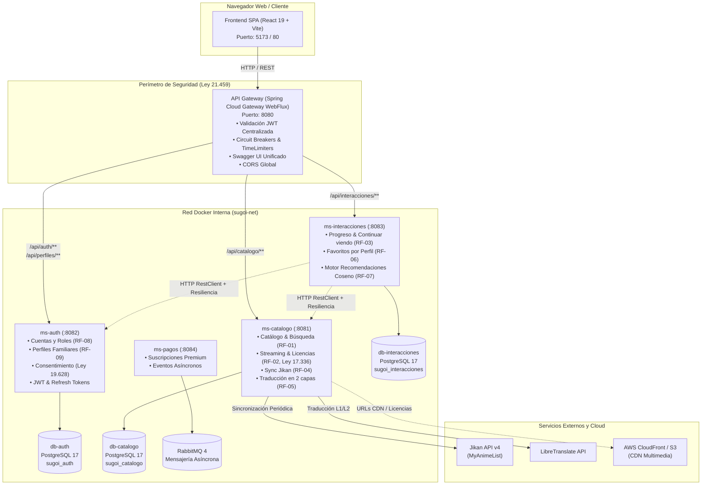

# SugoiAnime (すごいアニメ)
### Plataforma de Streaming de Anime Basada en Microservicios


**SugoiAnime** es una plataforma moderna de streaming y catálogo de anime diseñada bajo una **arquitectura de microservicios** distribuida, altamente escalable, resiliente y orientada al estricto cumplimiento normativo y legal chileno. 

El sistema incluye reproducción de video streaming, sincronización externa con metadatos de anime, gestión de identidades y perfiles familiares, seguimiento de progreso en tiempo real con throttling, favoritos con degradación elegante y un **motor de recomendaciones personalizadas** basado en aprendizaje de contenido (Similitud de Coseno).

---

## 📑 Tabla de Contenidos

- [Arquitectura del Sistema](#-arquitectura-del-sistema)
- [Mapa de Microservicios y Componentes](#-mapa-de-microservicios-y-componentes)
- [Funcionalidades y Requerimientos Implementados](#-funcionalidades-y-requerimientos-implementados)
  - [RF-01: Catálogo y Búsqueda de Anime](#rf-01-catálogo-y-búsqueda-de-anime)
  - [RF-02: Reproducción y Streaming Multimedia](#rf-02-reproducción-y-streaming-multimedia)
  - [RF-03: Progreso de Reproducción y "Continuar Viendo"](#rf-03-progreso-de-reproducción-y-continuar-viendo)
  - [RF-04: Sincronización Externa de Metadatos (Jikan API)](#rf-04-sincronización-externa-de-metadatos-jikan-api)
  - [RF-05: Traducción Automática con Caché Multinivel](#rf-05-traducción-automática-con-caché-multinivel)
  - [RF-06: Favoritos por Perfil con Degradación Elegante](#rf-06-favoritos-por-perfil-con-degradación-elegante)
  - [RF-07: Motor de Recomendaciones por Similitud de Coseno](#rf-07-motor-de-recomendaciones-por-similitud-de-coseno)
  - [RF-08 y RF-09: Identidad, Perfiles Familiares y Control Parental](#rf-08-y-rf-09-identidad-perfiles-familiares-y-control-parental)
- [Cumplimiento Normativo y Legal](#-cumplimiento-normativo-y-legal-chile)
- [Patrones de Resiliencia y Arquitectura Distribuida](#-patrones-de-resiliencia-y-arquitectura-distribuida)
- [Stack Tecnológico](#️-stack-tecnológico)
- [Referencia de la API REST (Gateway)](#-referencia-de-la-api-rest-gateway)
- [Guía de Instalación y Ejecución Local](#-guía-de-instalación-y-ejecución-local)
- [Pruebas Automatizadas](#-pruebas-automatizadas)

---

## 🏗️ Arquitectura del Sistema

El sistema implementa una arquitectura desacoplada orientada a microservicios:



---

## 📦 Mapa de Microservicios y Componentes

| Servicio / Contenedor | Puerto Interno (Docker) | Puerto Host (Dev) | Base de Datos / Storage | Responsabilidad Principal |
|---|:---:|:---:|---|---|
| **`gateway`** | `8080` | `8080` | N/A (Stateless) | Punto de entrada unificado, enrutamiento reactivo, filtro perimetral JWT, Resilience4j Circuit Breakers, CORS y documentación Swagger agregada. |
| **`ms-auth`** | `8082` | `5433` *(BD)* | `sugoi_auth` (PostgreSQL 17) | Gestión de identidades, emisión/rotación de tokens JWT, perfiles por cuenta y auditoría de consentimiento de datos personales. |
| **`ms-catalogo`** | `8081` | `5434` *(BD)* | `sugoi_catalogo` (PostgreSQL 17) | Catálogo de anime, géneros, gestión de episodios, streaming CDN y sincronización externa con Jikan. |
| **`ms-interacciones`** | `8083` | `5435` *(BD)* | `sugoi_interacciones` (PostgreSQL 17) | Registro de reproducciones, favoritos de usuarios y motor algebraico de recomendaciones personalizadas. |
| **`ms-pagos`** | `8084` | `5672 / 15672` *(MQ)* | RabbitMQ | Módulo para eventos asíncronos de membresías y suscripciones premium. |
| **`frontend`** | `80` | `5173` | Nginx / React SPA | Interfaz de usuario rica, reproductor HTML5 con control de posición y catálogo interactivo. |

---

## 🚀 Funcionalidades y Requerimientos Implementados

### RF-01: Catálogo y Búsqueda de Anime
- **Exploración Paginada y Filtros Dinámicos:** Listado de títulos con soporte de paginación (`page`, `size`, `sort`) y combinación de filtros opcionales por género, año de lanzamiento exacto y búsqueda de texto en título (`GET /animes`).
- **Ficha Técnica Detallada:** Consulta completa de información de un anime (`GET /animes/{id}`), incluyendo título original/inglés, sinopsis (en español), año, estado de emisión, puntuación y lista completa de episodios ordenados.
- **Top Valorados & Géneros:** Endpoints dedicados para el carrusel de animes mejor calificados (`GET /animes/top`) y catálogo de etiquetas de género (`GET /animes/generos`).
- **Sincronización en Frontend:** La vista de Catálogo (`/catalogo`) refleja y persiste automáticamente el estado de los filtros en los parámetros de la URL, permitiendo compartir enlaces y mantener el historial de navegación del usuario.

### RF-02: Reproducción y Streaming Multimedia
- **Entrega de Contenido CDN:** Endpoint de streaming (`GET /episodios/{id}/reproduccion`) que expone la URL optimizada servida a través de CDN (CloudFront / S3), duración y metadatos de reproducción.
- **Reproductor Interactivo HTML5:** Componente de video en frontend (`/ver/:episodioId`) con controles de reproducción, barra de tiempo interactiva, pantalla completa y gestión de estado.
- **Transparencia Legal:** Cada episodio emitido expone explícitamente su campo `licencia` (cumplimiento obligatorio de la **Ley 17.336**).

### RF-03: Progreso de Reproducción y "Continuar Viendo"
- **Seguimiento Idempotente:** Endpoint `PUT /progreso` que registra el segundo exacto, duración total y episodio en curso por perfil de usuario.
- **Finalización Automática:** El sistema detecta y marca automáticamente un episodio como completado cuando el usuario supera el 90% de su duración total.
- **Throttling en Cliente:** El frontend implementa el hook personalizado `useProgreso` con throttling a 10 segundos, asegurando que las actualizaciones se emitan periódicamente, al pausar o al abandonar la vista, evitando la saturación del Gateway.
- **Fila "Continuar Viendo":** Endpoint `GET /progreso/continuar` que lista los episodios comenzados y no terminados ordenados cronológicamente, descartando automáticamente aperturas accidentales (< 30 segundos visualizados).

### RF-04: Sincronización Externa de Metadatos (Jikan API)
- **Ingestión de Datos Automatizada:** Integración con la API REST pública de Jikan v4 (MyAnimeList) para poblar y actualizar catálogo, imágenes, episodios y puntuaciones.
- **Protección con Circuit Breaker:** Mecanismo Resilience4j que previene bloqueos ante caídas o lentitud de la API externa.
- **Rate Limiting y Control Manual:** Respeto estricto a las cuotas de peticiones de Jikan y endpoint administrativo (`POST /admin/sincronizar?paginas=N`) para disparar sincronizaciones manuales o programadas.

### RF-05: Traducción Automática con Caché Multinivel
- **Traducción de Sinopsis:** Integración con LibreTranslate para disponibilidad del catálogo en idioma español.
- **Arquitectura de Caché en Dos Capas (L1/L2):** 
  - **L1 (Memoria):** Caffeine Cache local de ultra-baja latencia.
  - **L2 (Persistencia):** Almacenamiento en base de datos PostgreSQL, evitando peticiones redundantes a la API de traducción.
- **Mantenimiento Administrativo:** Endpoint `POST /admin/traducir` para procesamiento por lotes de sinopsis pendientes.

### RF-06: Favoritos por Perfil con Degradación Elegante
- **Gestión de Favoritos:** Endpoints para marcar (`POST /favoritos`), desmarcar (`DELETE /favoritos/{animeId}`) y consultar estado instantáneo (`GET /favoritos/estado`) por perfil.
- **Enriquecimiento Resiliente:** Los favoritos almacenados en `ms-interacciones` se enriquecen dinámicamente con título, portada y puntuación consultando a `ms-catalogo`.
- **Degradación Elegante:** Si `ms-catalogo` no se encuentra disponible temporalmente, el servicio responde igualmente con los identificadores del perfil y la bandera `datosCompletos: false`, manteniendo la disponibilidad de la interfaz sin arrojar errores 500.
- **Vista de Usuario:** Página dedicada "Mis Favoritos" (`/favoritos`) en la aplicación React.

### RF-07: Motor de Recomendaciones por Similitud de Coseno
- **Filtrado Basado en Contenido (Content-Based Filtering):** Cada anime se representa como un vector binario en un espacio vectorial multidimensional de géneros.
- **Vector de Perfil:** El perfil de gustos del usuario se genera dinámicamente mediante la suma vectorial ponderada de los animes marcados como favoritos y los episodios completados.
- **Métrica de Similitud de Coseno:** Se calcula el ángulo entre el vector del perfil $\mathbf{u}$ y el vector del anime $\mathbf{v}$:
  $$\text{similitud}(\mathbf{u}, \mathbf{v}) = \frac{\mathbf{u} \cdot \mathbf{v}}{\|\mathbf{u}\| \|\mathbf{v}\|}$$
  Esto prioriza la **dirección y preferencia temática** en lugar de la cantidad absoluta de animes vistos (evitando sesgos entre usuarios novatos y veteranos).
- **Tratamiento del Arranque en Frío:** Si el perfil cuenta con menos de 2 interacciones, el sistema devuelve una lista vacía para no emitir sugerencias sin respaldo estadístico.
- **Pre-cálculo & Regeneración:** Endpoints para consultar recomendaciones (`GET /recomendaciones`) y forzar su regeneración inmediata (`POST /recomendaciones/regenerar`).

### RF-08 y RF-09: Identidad, Perfiles Familiares y Control Parental
- **Esquema de Identidad (`ms-auth`):** Base de datos relacional independiente (`sugoi_auth`) con soporte de cuentas maestras (`usuario`), hashing de contraseñas mediante BCrypt y roles (`usuario_rol`).
- **Perfiles por Cuenta (RF-09):** Soporte multi-perfil bajo una misma suscripción, asignación de avatares y bandera `es_infantil` como base para el filtrado de contenidos por edad (RF-11).
- **Sesiones Seguras:** Tabla `refresh_token` persistida en base de datos para permitir la expiración, rotación y el cierre de sesión real y revocable de tokens JWT.

---

## ⚖️ Cumplimiento Normativo y Legal (Chile)

El diseño arquitectónico de SugoiAnime incorpora controles para cumplir con la legislación chilena:

1. **Ley N° 17.336 (Propiedad Intelectual y Derechos de Autor):**
   - Todo el contenido multimedia servido posee un registro de trazabilidad en [`media/LICENCIAS.md`](file:///home/maha/Proyectos/sugoi-anime/media/LICENCIAS.md).
   - Solo se distribuyen obras de dominio público, material con licencias Creative Commons (ej. CC BY 3.0) o trailers promocionales libres.
   - El endpoint `GET /episodios/{id}/reproduccion` expone la licencia obligatoria que el reproductor web renderiza bajo el video.
2. **Ley N° 19.628 (Protección de la Vida Privada y Datos Personales):**
   - Tabla `consentimiento` en `ms-auth`: se registra evidencia auditable del consentimiento del usuario (versión de términos, tipo de autorización, IP de origen y marca de tiempo).
   - El historial de interacciones para el cálculo de recomendaciones (RF-07) solo se procesa bajo consentimiento explícito.
3. **Ley N° 21.459 (Delitos Informáticos y Seguridad Perimetral):**
   - Perímetro de seguridad centralizado en el Gateway (`gateway`).
   - Aislamiento de microservicios en una red Docker privada (`sugoi-net`) sin exposición de puertos de base de datos a internet.
   - Validación estricta y sin estado de tokens JWT firmados criptográficamente.

---

## 🛡️ Patrones de Resiliencia y Arquitectura Distribuida

- **Database-per-Service (RNF-02):** Aislamiento estricto de datos. `ms-auth`, `ms-catalogo` y `ms-interacciones` poseen esquemas y motores PostgreSQL independientes sin claves foráneas físicas cruzadas. La integridad referencial entre dominios es gestionada en la capa de aplicación (`PerfilGuard`, RestClients).
- **Circuit Breaker & TimeLimiter (Resilience4j):** Implementados tanto a nivel de Gateway (rutas WebFlux) como en llamadas inter-servicio (`ms-interacciones` $\rightarrow$ `ms-catalogo` y `ms-auth`).
- **Trazabilidad Distribuida:** Inyección y propagación automática del encabezado de correlación `X-Correlation-Id` en el Gateway para auditoría de extremo a extremo.
- **Degradación Elegante (Graceful Degradation):** Servicios capaces de responder con información parcial o estados por defecto en caso de indisponibilidad de dependencias.

---

## 🛠️ Stack Tecnológico

### Backend
- **Lenguaje:** Java 25 (Project Loom / Virtual Threads habilitados para I/O concurrente eficiente).
- **Framework Base:** Spring Boot 4.1.1.
- **Cloud & Gateway:** Spring Cloud 2025.1.3, Spring Cloud Gateway Server WebFlux.
- **Resiliencia:** Resilience4j (Circuit Breakers, TimeLimiters).
- **Seguridad:** Spring Security con OAuth2 Resource Server (JWT HMAC-SHA256).
- **Persistencia & ORM:** Spring Data JPA, Hibernate, HikariCP.
- **Migraciones:** Flyway para versionado de esquemas relacionales.
- **Caché:** Caffeine Cache en memoria.
- **Mensajería:** Spring AMQP + RabbitMQ 4 (eventos de suscripciones y pagos).
- **Documentación de API:** SpringDoc OpenAPI 3.1.0 / Swagger UI.

### Frontend
- **Librería Core:** React 19 + ReactDOM 19.
- **Tooling & Bundler:** Vite 8.
- **Enrutamiento:** React Router DOM v7.
- **Estilos:** Vanilla CSS modular con variables de diseño, tema oscuro cinemático y diseño responsivo.
- **Despliegue:** Nginx Alpine.

### Infraestructura y Datos
- **Bases de Datos:** PostgreSQL 17 Alpine (3 instancias independientes: `db-auth`, `db-catalogo`, `db-interacciones`).
- **Contenedores:** Docker & Docker Compose con builds multi-etapa (*multi-stage*).

---

## 🔌 Referencia de la API REST (Gateway)

Todas las peticiones del frontend se canalizan a través del API Gateway en el puerto `8080`:

### Catálogo y Streaming (`/api/catalogo/**`)
| Método | Ruta | Parámetros Clave | Descripción |
|---|---|---|---|
| `GET` | `/api/catalogo/animes` | `genero`, `anio`, `texto`, `page`, `size`, `sort` | Listado paginado de animes con filtros combinables (RF-01). |
| `GET` | `/api/catalogo/animes/{id}` | `id` (path) | Detalle completo de un anime, géneros y episodios. |
| `GET` | `/api/catalogo/animes/top` | `page`, `size` | Lista de animes mejor valorados. |
| `GET` | `/api/catalogo/animes/generos` | — | Lista de géneros disponibles en el catálogo. |
| `GET` | `/api/catalogo/episodios` | `animeId` (query) | Lista de episodios asociados a un anime. |
| `GET` | `/api/catalogo/episodios/{id}/reproduccion` | `id` (path) | URL de CDN, duración y licencia de streaming (RF-02). |
| `POST` | `/api/catalogo/admin/sincronizar` | `paginas` (default: 2) | Disparo manual de sincronización con Jikan API (RF-04). |
| `POST` | `/api/catalogo/admin/traducir` | — | Disparo manual de traducción de sinopsis pendientes (RF-05). |

### Interacciones y Recomendaciones (`/api/interacciones/**`)
| Método | Ruta | Parámetros Clave | Descripción |
|---|---|---|---|
| `GET` | `/api/interacciones/favoritos` | `perfilId`, `page`, `size` | Lista paginada de favoritos enriquecidos del perfil (RF-06). |
| `POST` | `/api/interacciones/favoritos` | `perfilId`, `animeId` | Marcar un anime como favorito (RF-06). |
| `DELETE` | `/api/interacciones/favoritos/{animeId}` | `animeId` (path), `perfilId` (query) | Quitar un anime de favoritos. |
| `GET` | `/api/interacciones/favoritos/estado` | `perfilId`, `animeId` | Consulta de estado para pintar botón de favoritos en la UI. |
| `PUT` | `/api/interacciones/progreso` | `GuardarProgresoRequest` (body JSON) | Guardar punto de visualización con detección de fin (RF-03). |
| `GET` | `/api/interacciones/progreso/episodio/{id}` | `id` (path), `perfilId` (query) | Obtener segundo actual visto de un episodio. |
| `GET` | `/api/interacciones/progreso/anime/{id}` | `id` (path), `perfilId` (query) | Progreso de todos los episodios de una serie. |
| `GET` | `/api/interacciones/progreso/continuar` | `perfilId`, `limite` (default: 10) | Carrusel "Continuar viendo" (> 30s y no completados). |
| `GET` | `/api/interacciones/recomendaciones` | `perfilId` (query) | Recomendaciones personalizadas por similitud de coseno (RF-07). |
| `POST` | `/api/interacciones/recomendaciones/regenerar`| `perfilId` (query) | Fuerza el recálculo inmediato de sugerencias por perfil. |

### Documentación Swagger Unificada
Una vez levantado el Gateway, la consola Swagger que agrega la documentación OpenAPI de todos los servicios está disponible en:
```
http://localhost:8080/swagger-ui.html
```

---

## 💻 Guía de Instalación y Ejecución Local

### 1. Prerrequisitos
- **Java 25 JDK** instalado y configurado en el `PATH`.
- **Node.js 20+** y `npm`.
- **Docker** y **Docker Compose** en ejecución.

### 2. Configurar Variables de Entorno
Copia la plantilla de variables de entorno y ajusta los valores necesarios:
```bash
cp .env.example .env
```

### 3. Levantar Bases de Datos e Infraestructura
Inicia las instancias de PostgreSQL 17 y RabbitMQ en segundo plano:
```bash
docker compose -f docker-compose.dev.yml up -d
```
> Esto inicializará los tres contenedores PostgreSQL (`db-auth:5433`, `db-catalogo:5434`, `db-interacciones:5435`).

### 4. Compilar y Ejecutar los Microservicios

Abre terminales separadas para cada servicio:

```bash
# Terminal 1: ms-catalogo (Puerto 8081)
cd ms-catalogo
./mvnw spring-boot:run

# Terminal 2: ms-interacciones (Puerto 8083)
cd ms-interacciones
./mvnw spring-boot:run

# Terminal 3: API Gateway (Puerto 8080)
cd gateway
./mvnw spring-boot:run
```

### 5. Iniciar la Interfaz Web (Frontend)

```bash
cd frontend
npm install
npm run dev
```
La aplicación estará disponible en `http://localhost:5173`.

---

## 🧪 Pruebas Automatizadas

Cada microservicio cuenta con suites de pruebas unitarias y de integración (usando JUnit 5, Mockito y Testcontainers):

```bash
# Pruebas de ms-catalogo (repositorios, filtros y servicios)
cd ms-catalogo && ./mvnw test

# Pruebas de ms-interacciones (algoritmo matemático de similitud de coseno, progreso y resiliencia)
cd ms-interacciones && ./mvnw test
```
